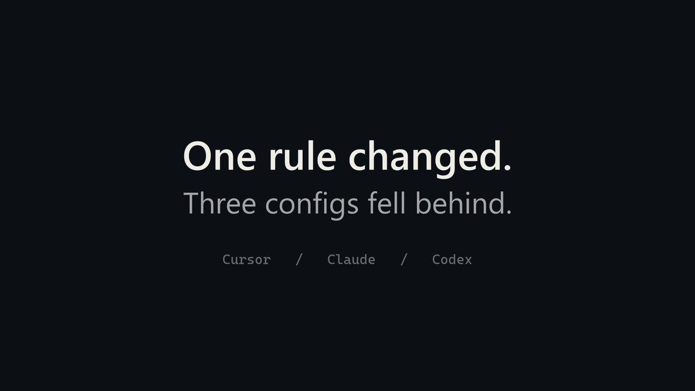

<p align="center">
  <a href="https://github.com/kok-o/contextos-agents">
    
  </a>
</p>

<h1 align="center">contextos-agents</h1>

<p align="center">
  <strong>Maintain your coding-agent rules in one place.</strong><br />
  Export them to supported tools and catch outdated configs in CI.
</p>

<p align="center">
  <a href="https://www.npmjs.com/package/contextos-agents"></a>
  <a href="https://www.npmjs.com/package/contextos-agents"></a>
  <a href="https://nodejs.org/"></a>
  <a href="./LICENSE"></a>
  <a href="https://github.com/kok-o/contextos-agents/actions/workflows/validate-skills.yml"></a>
</p>

<p align="center">
  <a href="#quickstart">Quickstart</a> ·
  <a href="#supported-agents">Supported agents</a> ·
  <a href="./GUIDE.md">Guide</a> ·
  <a href="./CONTRIBUTING.md">Contributing</a>
</p>

---

Using several coding agents in the same project? A rule updated for one tool can
leave another tool's configuration behind. ContextOS keeps your rules in
version-controlled Markdown, exports them to supported agent formats, and checks
whether those exports still match their sources.

It is useful when you or your team maintain instructions across multiple tools
or need a configuration check before merging changes. If a small, stable
instruction file already covers your workflow, you may not need an extra tool;
see [alternatives](docs/ALTERNATIVES.md) for an honest comparison.

<p align="center">
  
</p>

<p align="center"><sub>Change a rule. Catch stale exports. Bring them back in sync.</sub></p>

<a id="installation"></a>

## Quickstart

This checkout prepares **core 3.0.0**. Publication is a separate step; see the
[stable release checklist](docs/RELEASE_3.0.0.md). The npm badge above describes
the published package, not this checkout. MCP has its own release path.

Requires **Node.js 22+** and npm. Run these commands in your project's root.
This workflow does not call a model API.

**1. Prepare the rule sources.**

The registry install below is for after 3.0.0 is published. During preparation,
install the [reviewed local archive](docs/RELEASE_3.0.0.md#try-the-prepared-archive).

```sh
npm install --save-dev --save-exact contextos-agents@3.0.0
npx --no-install contextos init
```

This creates `.agents/project/skills/` for your rules and adds a `.gitignore`
block for derived caches. Nothing else is copied into your project: the compiler
runs from the package, and the bundled engineering rules are opt-in
(`--with-core`). See the [guide](GUIDE.md#initialization-options) for presets,
previews and a pinned project dependency.

**2. Add a rule your team wants to maintain.**

Save this as `.agents/project/skills/team-auth/SKILL.md`:

```markdown
---
name: team-auth
description: "Team rules for authentication code."
activation: always
---
# Team security

- Never log authorization headers.
```

`activation` decides how the rule reaches each agent: `always` (part of every
session), `globs` (only for matching files, with a `globs:` list) or `auto`
(the agent decides from the description; the default).

Optional manifests use `skill.v2.yaml` before `skill.yaml` and can declare an
entrypoint and resources. Their activation fields override entrypoint
frontmatter; see the [source and activation contract](GUIDE.md#activation-how-a-rule-reaches-an-agent).

**3. Compile, export, and check.**

```sh
npx --no-install contextos compile
npx --no-install contextos export all
npx --no-install contextos export all --check --json
```

The check should report `"status": "pass"`, `"hasDrift": false`, and exit code
`0`. The rule is now in the files each agent reads, for example
`.claude/rules/team-auth.md`, `.cursor/rules/team-auth.mdc` and
`.agents/skills/team-auth/SKILL.md`.

**See drift detection:** add `- Never log session tokens.` to the same source
file, then run:

```sh
npx --no-install contextos export all --check --json
```

The check reports `"status": "drift"` and exits with code `1`: the exports are
out of date. Run `npx --no-install contextos export all` and check again to return to
`pass`. Commit the source rules, generated files and lockfile together.

Edit your rules under `.agents/project/skills/`; generated files are managed
outputs. To use a single adapter, replace `all` with its name, for example
`cursor`. Files you already have, such as `CLAUDE.md` or a Copilot instruction
file, keep your text; ContextOS refuses to overwrite a file it did not write
(`--force` replaces it explicitly). See the
[step-by-step onboarding guide](docs/product/onboarding.md).

## How a rule reaches each agent

| Client | `always` | `globs` | `auto` |
| --- | --- | --- | --- |
| Claude Code | `.claude/rules/<name>.md` (loaded at launch) | `.claude/rules/<name>.md` with `paths:` | `.claude/skills/<name>/SKILL.md` |
| Cursor | `.cursor/rules/<name>.mdc`, `alwaysApply: true` | same file, `globs:` | same file, agent-requested |
| GitHub Copilot | body inside `.github/copilot-instructions.md` | routing table with source path | routing table with source path |
| Aider | body inside `CONVENTIONS.md` | skill index with `/read` hint | skill index with `/read` hint |
| Codex, Gemini CLI | `.agents/skills/<name>/SKILL.md` (a skill the client selects from its description) | same | same |
| Zed | `.zed/rules.md` and `.zed/prompts/<name>.md` (manual import) | same | same |

## Working in a team

Generated files are committed so that CI can check them. Two branches that edit
different rules merge cleanly; if they add neighbouring rules, git may report a
conflict in an aggregate file such as `CONVENTIONS.md` or in
`.agents/lockfile.v2.json`. Rule sources never conflict this way. Resolve any
source conflict, then run one command, which rebuilds every generated file from
the sources, including files that still hold conflict markers:

```sh
npx --no-install contextos export all
```

Details, including CRLF checkouts and what to commit, are in the
[team workflow](docs/TEAM_WORKFLOW.md).

## Check rule changes in CI

After committing a fresh export, run the same consistency check on pull requests.
It checks agent configuration; your application's tests and security checks
remain separate.

<details>
<summary>GitHub Actions example</summary>

The following example becomes usable only after the 3.0.0 package and tag are
published. During preparation, use `npx --no-install contextos gate --target all`
with the reviewed local package installed.
After publication, save as `.github/workflows/contextos.yml`:

```yaml
name: Agent rule consistency
on: [pull_request, push]
jobs:
  check:
    runs-on: ubuntu-latest
    steps:
      - uses: actions/checkout@v4
      - uses: kok-o/contextos-agents/.github/actions/contextos-gate@v3.0.0
        with:
          version: '3.0.0'
          adapters: 'all'
          working-directory: '.'
```

Set `adapters` to the adapter or adapters you actually exported.
See [CI configuration](GUIDE.md#ci-configuration-check) for version pinning.

</details>

<a id="supported-agents--compilation"></a>

## Supported agents

| Agent | What ContextOS writes |
| --- | --- |
| Claude Code | `.claude/rules/*.md` and `.claude/skills/*/SKILL.md`; your `CLAUDE.md` is not touched. |
| Cursor | Modular `.cursor/rules/*.mdc` files. |
| GitHub Copilot | A managed block in `.github/copilot-instructions.md`; text outside it is yours. |
| Codex, Gemini CLI | Shared native skills in `.agents/skills/*/SKILL.md`. |
| Aider | `CONVENTIONS.md` referenced by `.aider.conf.yml`. |
| Zed | Templates for manual import. |

Export tests and live client loading are separate checks, and so is whether a
model follows what it loaded. The [compatibility matrix](docs/ADAPTER_COMPATIBILITY.md)
records which of the three was verified for each client, with versions and
limitations.

## Beyond the first rule

- **Reuse skills:** install catalog skills and stack presets, or keep team
  overrides. See [skill management](GUIDE.md#skill--catalog-management-skill).
- **Inspect task relevance:** `resolve` recommends skills for a task and explains
  the selection, including your own rules (matched on name and description). It
  does not install or activate them. Ordinary exports use the installed skills
  allowed by the profile, independently of a task's selection.
  See [resolution](GUIDE.md#dynamic-skill-resolution-resolve).
- **Inspect staged changes:** the separate `scan` command and optional hooks
  check supported secret, placeholder, and write-scope patterns. They report
  only, unless run with `--enforce`. See
  [scanning and hooks](GUIDE.md#security-scanning--governance-hooks).
- **Upgrade from 2.x:** run `npx --no-install contextos update`; see
  [upgrading](docs/MIGRATION.md#upgrading-from-2x-projects).

## Scope and evidence

The core CLI manages rule sources, selection, exports and configuration checks.
The optional [MCP package](contextos-mcp/README.md) is separate and maintained
only for security and compatibility (`npm install --save-dev contextos-mcp`); agent
execution and runtime orchestration remain experimental and are not expanded.
Resuming MCP development requires a separate decision and a confirmed user scenario.
Core has independent stable and RC [release paths](docs/RELEASE_PROCESS.md).
Migration of the separate MCP package to its own maintenance workflow remains
separate work.

Consistent configuration does not guarantee that a model follows every rule.
The [recorded calibration](docs/BENCHMARK_RESULTS.md) found no quality advantage
over vanilla on its test corpus. ContextOS is not a sandbox and does not restrict
what an agent does; see the [security model](docs/SECURITY.md). Install
third-party skills only from sources you trust: their instructions are not
sandboxed.

## Documentation

| I want to… | Read |
| --- | --- |
| Look up commands, presets, profiles, and diagnostics | [Guide and cheat sheet](GUIDE.md) |
| Try a task with a custom team rule | [Onboarding](docs/product/onboarding.md) |
| Work with branches, merges and CI | [Team workflow](docs/TEAM_WORKFLOW.md) |
| Check agent-specific behavior | [Compatibility matrix](docs/ADAPTER_COMPATIBILITY.md) |
| Compare with other ways to do this | [Alternatives](docs/ALTERNATIVES.md) |
| Understand the guarantees and limits | [Security model](docs/SECURITY.md) |
| Understand the compiler and support boundaries | [Architecture](docs/ARCHITECTURE.md) · [Product boundaries](docs/PRODUCT_BOUNDARIES.md) |
| Upgrade or recover a previous configuration | [Migration and rollback](docs/MIGRATION.md) |
| Review release evidence | [Changelog](CHANGELOG.md) · [archived release records](docs/archive/README.md) |

## Contributing

Bug reports, documentation fixes, and examples from real projects are welcome.
See [CONTRIBUTING.md](CONTRIBUTING.md) or
[open an issue](https://github.com/kok-o/contextos-agents/issues).

## License

[Apache-2.0](LICENSE). See [NOTICE](NOTICE) for attribution.
