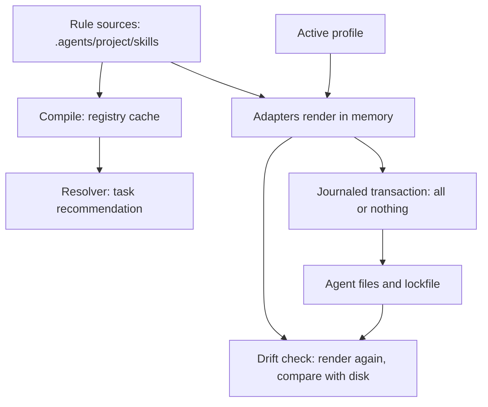

# ContextOS Core Architecture

## Product boundary

The stable `contextos-agents` package manages version-controlled engineering
rules for supported AI coding agents. It validates rule sources, renders
agent-native files, and detects when those files no longer match their sources.

The MCP server is an optional separate package, maintained only for security and
compatibility. Existing orchestration and execution features are experimental;
they are not expanded during the freeze or covered by the core contract. Resuming
development requires a separate decision and a confirmed user scenario.

## What lives where

| Place | Holds | Who owns it |
| --- | --- | --- |
| `node_modules/contextos-agents` | The tool: CLI, compiler, adapters, resolver, schemas, bundled core rules and the skill catalog | The package; never copied into a project |
| `.agents/project/skills/` | Your rules | You |
| `.agents/core/`, `.agents/AGENTS.md` | Optional bundled rules (`init --with-core`) | Copied once; refreshed by `update` |
| Agent files (`.claude/`, `.cursor/rules/`, `.agents/skills/`, Copilot, Aider, Zed) | Generated output | ContextOS, recorded in the lockfile |
| `.agents/lockfile.v2.json` | Path, generator and content hash of every generated file | Generated; committed |
| `.agents/compiled/`, `.agents/.contextos/` | Registry cache and transaction journals | Derived; ignored by git |

## Core data flow

Rendering is pure: an adapter turns the rule set into a list of artifacts in
memory. Applying them and checking them are separate steps over that list, so
`export` and `export --check` cannot disagree about what the output should be.

## Components

### Sources and activation

A rule uses `skill.v2.yaml`, then `skill.yaml`, then a manifestless `SKILL.md`.
Compiler, validator and adapters honor the selected manifest's `entrypoint` and
contained file resources. Entrypoints, manifests and resources reject real-path
escapes before reading. Manifest `activation` and `globs` override entrypoint
frontmatter; `adapters/shared.js` resolves their contract for compilation and all
exports. The compiled registry records the effective mode and scopes. Client
mapping and its limits are in the [compatibility matrix](ADAPTER_COMPATIBILITY.md).
Relative Markdown links are rebased when exported entrypoints or resources move;
fenced examples retain literal links.

### Resolver

`resolve` recommends rules for a task from the task text, touched files and the
workspace. Catalog skills use built-in signals; your own rules are matched on
their name and description. It recommends; adapters do not consume its output:
an export contains every installed rule that the profile allows.
Resolver `signals.fileGlobs` match complete paths with globstars and brace groups;
they are separate from adapter activation scopes. Missing mandatory guidance and
unavailable prerequisites produce diagnostics, including with `--installed-only`.

### Adapters and the lockfile

Adapters are deterministic: same sources, same bytes, whatever line endings the
checkout uses. The lockfile records each generated file by path, generator and
hash, sorted by path, with nothing that changes on every run. Files that also
hold user text (Copilot instructions) record only the hash of the generated
block. See the [team workflow](TEAM_WORKFLOW.md) for how this behaves in merges.

### Safe writes

Every filesystem change by `export`, `init`, `update` and `uninstall` is staged in
a journaled transaction that resolves each path inside the project root and
refuses symlink or junction escapes, checks the previous hash of each file it
replaces, and rolls back on failure. A file is replaced or deleted only if
ContextOS wrote it and it is unchanged. `bin/lib/safe-writer.js` only plans.

### CI quality gate

`contextos gate` and `export --check` compare rendered output with disk.
Application tests, type checks, secret scanning and policy validation are
separate; passing this gate does not establish application correctness.

## Separate packages and experimental features

The read-only MCP server is maintained in `contextos-mcp`. Core stable and core
RC releases have dedicated identities, tags and workflows. Migration of MCP to
its own maintenance workflow and checked standalone source copies is separate
work; this core preparation does not change MCP. Task routing, subagent
orchestration and execution sandboxes are experimental; they carry separate
requirements and guarantees from the stable core. Core builds its plugin
supply-chain check from `.agents/transaction-core/supply-chain-src` into
`.agents/transaction-core/plugin-supply-chain-bundle.js` without reading or
building the MCP checkout. Companion source synchronization and IPC lock copies
are optional tooling for a separately reviewed MCP maintenance change.
See [CONTRIBUTING](../CONTRIBUTING.md) and [release instructions](RELEASE_PROCESS.md).
